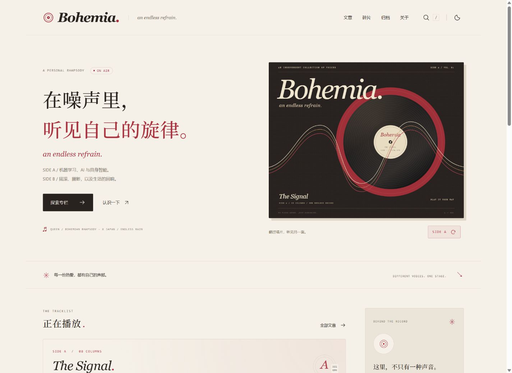

# Bohemia

> 不同的声音，同一场共鸣。

源码仓库：[ElysiaTT/Bohemia](https://github.com/ElysiaTT/Bohemia) · 默认分支：`main`

一个为 GitHub Pages 制作的中文个人博客。名字取自 Queen 的《Bohemian Rhapsody》（《波西米亚狂想曲》），以原创黑胶封套、奶油纸色与酒红色建立视觉。每个专栏将像一支不同的摇滚乐队，组成同一个自由表达的舞台。

首页是一张可翻面的唱片：**Side A — The Signal** 收录 8 个技术专栏，**Side B — The Afterglow** 收录 6 个生活专栏。博客副标题 **an endless refrain.** 呼应 X JAPAN《ENDLESS RAIN》。文章原有的技术、设计、生活、随想分类仍用于文章列表，不代替专栏。



[手机预览](docs/preview-mobile.jpg)

[Side A 专栏](docs/record-side-a-columns.jpg) · [Side B 专栏](docs/record-side-b-columns.jpg) · [Side B 封面](docs/record-side-b.jpg)

[手机专栏排版](docs/columns-mobile.jpg) · [平板深色排版](docs/columns-tablet-dark.jpg)

## 本地运行

推荐 Node.js 24 LTS。已在本机 Node.js 22.14.0 上通过构建与功能检查；当前字体工具的间接依赖会提示 Node.js 22.19.0 的引擎要求，安装新环境时请优先使用 Node.js 24。

```powershell
cd D:\study\blog_web
npm install
npm run dev
```

打开终端显示的地址，通常是 `http://127.0.0.1:4321/`。依赖已经安装，首次查看可直接运行 `npm run dev`。

```powershell
npm run check    # 内容与类型检查
npm run build    # 输出静态网站到 dist/
npm run verify   # 检查构建结果的链接、锚点、搜索、RSS 与站点地图
npm run preview  # 预览已经构建的网站
```

## 已包含

- 首页、文章列表、文章详情、碎片、时间归档、关于、404。
- 明暗主题与偏好记忆、手机导航、键盘可操作的搜索弹窗。
- 标题 / 摘要 / 标签 / 正文搜索，分类筛选与可分享的筛选地址。
- 文章目录、阅读进度、代码高亮、代码复制、文章链接复制。
- RSS、站点地图、robots.txt、canonical、Open Graph 与文章结构化数据。
- 全部封面与展示字体保存在本地；访问时不依赖外部字体或图片服务。
- GitHub Actions 自动检查、构建、发布；兼容用户主页与普通项目仓库路径。

当前 6 篇文章和 4 条碎片是原创示例，用于展示版式，已在文章页及关于页说明。请替换为自己的内容再正式运营。没有虚构个人履历、评论、访问量或社交账号。

## 修改个人信息

编辑 `src/data/site.json`：

| 字段 | 用途 |
| --- | --- |
| `title` / `author` | 站点名称 / 作者署名 |
| `subtitle` / `description` | 标语 / 搜索引擎描述 |
| `hero` | 首页大标题与介绍 |
| `url` | 正式域名，如 `https://YOUR_NAME.github.io`；本地可以留空 |
| `github` | 你的 GitHub 完整主页地址；留空时不展示 |
| `email` | 联系邮箱；留空时不展示 |

个人介绍位于 `src/pages/about/index.astro`，碎片位于 `src/data/notes.json`，配色与布局位于 `src/styles/global.css`。

## 写第一篇文章

### 将文章收入专栏

14 个专栏及其说明统一保存在 `src/data/tracklist.json`。专栏是长期写作方向，不是已经发布的文章；没有文章的栏目显示「即将更新」，不会生成空链接。

每个专栏横向占满内容区，标题与中文说明下展示最近最多 4 篇相关文章。桌面为两列图片卡片，手机为单列；「全部文章」链接进入该专栏归档。首页不再另列一份重复的文章卡片流。

目前两面各一个专栏配置了 `layoutPreviewPosts`，使用现有示例文章演示排版，并显示「排版示例／不计入本专栏」说明。这些 ID 不会修改文章归属、生成专栏归档或计入正式文章数量；一旦该专栏有真实文章，排版示例会自动让位。其余空专栏继续显示「即将更新」。

在真实文章的 frontmatter 中增加 `column: "wish-you-were-real"`（或其他栏目 slug），同时保持 `draft: false`、`demo: false`。构建会自动生成 `columns/wish-you-were-real/`，汇总该专栏所有已发布文章。未声明 `column` 的原有示例不会被强行归类；未知栏目 slug 会在内容检查时报告错误。

首页每次打开默认 Side A。封面右下角的 `SIDE A ↻` 按钮可用鼠标、Enter 或空格操作，统一切换封面、专栏和 Now Playing。封面翻面约 820ms，按钮呼吸约 3 秒；减少动态效果时即时切换。两面专栏共享高度，隐藏的一面使用 `inert` 与 `aria-hidden` 退出键盘及辅助技术导航。

### 新建草稿

```powershell
npm run new -- my-first-post "我的第一篇文章"
```

脚本会创建 `src/content/posts/my-first-post.md`，不会覆盖同名文件。日期按北京时间填写；新文章默认为草稿，不会出现在网站、搜索和 RSS 中。写完后将 `draft: true` 改为 `draft: false`。

```yaml
---
title: "我的第一篇文章"
description: "用一句话介绍这篇文章。"
date: 2026-11-10
category: "技术" # 技术 / 设计 / 生活 / 随想
tags: ["学习", "笔记"]
cover: "images/my-cover.webp" # 可选；文件放 public/images/
coverAlt: "图片的文字说明" # 可选
featured: false # 首页精选：按日期选取最新一篇 featured 文章
draft: false
demo: false
---

## 从这里开始

写下你的正文。
```

封面路径不加开头的 `/`，链接会自动补上 GitHub Pages 子路径。文章文件名使用小写英文、数字、短横线；生成的 URL 为 `posts/文件名/`。发布文章时直接新增 Markdown 文件即可，无须修改页面代码。若新增分类，请同步更新 `src/content.config.ts` 与 `src/lib/posts.ts`。

展示字体为现有标题、碎片和引用制作的 Noto Serif SC 子集；新字符会自动使用系统衬线字体。需要更新子集时运行 `python scripts/fetch-assets.py`（也会重新下载示例图片；仅更新字体可加 `--fonts-only`）。正文使用本地系统字体。

Bohemia 的原创封套保存在 `public/images/bohemia-cover.svg`；编辑后运行 `npm run brand`，重新生成适合社交分享的 `bohemia-og.png`。首页和关于页的音乐意象表达博客的组织方式，原有文章分类暂未替换为乐队名称。

## 部署到 GitHub Pages

本项目已包含 `.github/workflows/deploy.yml`，无需添加 Token。

Pages 尚未启用时，推送会自动完成内容检查、静态构建和链接验证，并跳过发布。将 Pages 的 Source 设为 GitHub Actions 后，再推送或手动运行工作流即可发布。

1. 在自己的 GitHub 账号下新建公开仓库。个人主页建议命名为 `YOUR_NAME.github.io`；普通仓库如 `blog` 也支持。
2. 将项目内容提交到仓库的 `main` 分支。不要上传 `node_modules/`、`dist/` 或 `.local/`。
3. 打开仓库 **Settings → Pages → Build and deployment → Source**，选择 **GitHub Actions**。
4. 推送一次提交，或在 **Actions → Deploy Bohemia to GitHub Pages → Run workflow** 手动执行。
5. 等待检查、构建与部署成功。个人主页为 `https://YOUR_NAME.github.io/`；项目站为 `https://YOUR_NAME.github.io/blog/`。

工作流通过官方 `configure-pages` 的输出自动设置域名与子路径。CSS、字体、图片、内部链接、搜索、RSS 与站点地图都遵循该路径，不必手动批量改链接。

首次连接仓库时，在项目根目录执行下面的命令，并将 `YOUR_NAME` 替换成自己的用户名：

```powershell
git init -b main
git add .
git commit -m "Build Bohemia blog"
git remote add origin https://github.com/YOUR_NAME/YOUR_NAME.github.io.git
git push -u origin main
```

如果远端仓库已经有内容，请先使用已有仓库的 Git 流程合并，不要强制推送覆盖。本站的目标仓库为 `ElysiaTT/Bohemia`；网站发布还需在仓库 Pages 设置中启用 GitHub Actions。工作流会自动使用 `/Bohemia/` 项目路径。

自定义域名：先在 GitHub Pages 配置域名及 DNS，再将完整域名写入 `src/data/site.json` 的 `url`。工作流会继续使用 Pages 返回的正式地址。

## 项目结构

```text
.github/workflows/deploy.yml    自动部署
public/images/                 本地封面
public/fonts/OFL.txt            字体许可证
src/assets/                    展示字体子集
src/content/posts/             Markdown 文章
src/data/site.json             站点与个人信息
src/data/notes.json            碎片内容
src/layouts/Base.astro          统一导航、元信息、页脚
src/pages/                     页面与 RSS / 搜索端点
src/styles/global.css          全站设计与响应式布局
scripts/new-post.mjs            安全创建新文章
scripts/fetch-assets.py         可选：恢复示例素材与更新字体子集
```

## 设计参考与素材来源

参考的是信息组织与阅读体验，站点布局、配色与品牌标识为独立实现，没有复制参考网站的代码或文章。

- [Anthony Fu](https://antfu.me/)：个人博客与技术、生活内容的自然组织。
- [Maggie Appleton](https://maggieappleton.com/)：数字花园与持续生长的笔记。
- [Josh W. Comeau](https://www.joshwcomeau.com/)：文章导航与阅读交互细节。
- [Astro 官方 GitHub Pages 部署文档](https://docs.astro.build/en/guides/deploy/github/)。
- [GitHub Pages 官方建站文档](https://docs.github.com/en/pages/getting-started-with-github-pages/creating-a-github-pages-site)。

示例图片来自 Unsplash，按 [Unsplash License](https://unsplash.com/license) 使用；不是博主个人拍摄或旅行经历。源码中的 `scripts/fetch-assets.py` 保存了可恢复的图片地址。

| 本地文件 | 原始来源 |
| --- | --- |
| `mountains.webp` | [Max · Lake O'Hara](https://unsplash.com/photos/a-lake-surrounded-by-mountains-EkWjVVluDEI) |
| `forest.webp` | [Unsplash 原图](https://images.unsplash.com/photo-1441974231531-c6227db76b6e) |
| `desk.webp` | [Unsplash 原图](https://images.unsplash.com/photo-1499750310107-5fef28a66643) |
| `architecture.webp` | [Unsplash 原图](https://images.unsplash.com/photo-1487958449943-2429e8be8625) |
| `coast.webp` | [Unsplash 原图](https://images.unsplash.com/photo-1475924156734-496f6cac6ec1) |
| `books.webp` | [Unsplash 原图](https://images.unsplash.com/photo-1507842217343-583bb7270b66) |

字体为 [Noto Serif SC](https://fonts.google.com/noto/specimen/Noto+Serif+SC)，使用 SIL Open Font License 1.1，许可证随项目保存在 `public/fonts/OFL.txt`。首页黑胶封套与唱片标识为项目内原创 SVG，保存在 `public/images/bohemia-cover.svg` 与 `public/favicon.svg`。
